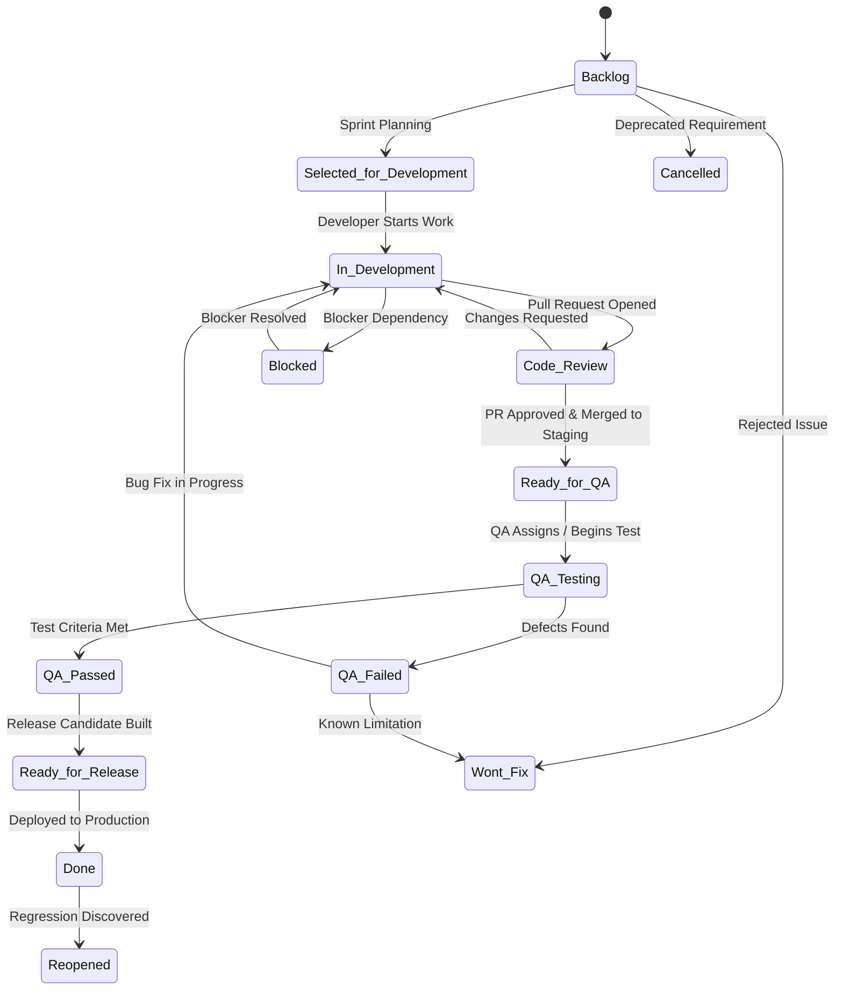

# Curatal WorkHub — Phase 0: Project Configuration & Workflow Blueprint

**Document ID:** `docs/06_CURATAL_PROJECT_CONFIGURATION_BLUEPRINT.md`  
**Organization:** Curatal  
**Status:** Planning & Architectural Blueprint (For Phase 1 Implementation)  
**Author:** Senior Software Architect & Lead Agile Coach  

---

## 1. Project Hierarchy Blueprint

Curatal WorkHub hosts projects representing Curatal's core platform architecture, user-facing portals, infrastructure, and product roadmaps.

### 1.1 Curatal Project Portfolio Matrix
| # | Project Name | Target Project Key | OpenProject Identifier (Slug) | Scope & Purpose |
| :-: | :--- | :--- | :--- | :--- |
| 1 | **Curatal Core & APIs** | `CORE` | `curatal-core` | Shared backend services, GraphQL/REST endpoints, database schemas. |
| 2 | **Recruiter Portal** | `REC` | `recruiter-portal` | Recruiter talent acquisition workflow, candidate sourcing, job posts. |
| 3 | **Candidate Portal** | `CAN` | `candidate-portal` | Candidate job application, interview scheduling, profile management. |
| 4 | **Interviewer Portal** | `INT` | `interviewer-portal` | Technical interviewer dashboard, scorecards, live evaluation. |
| 5 | **Assessment Platform** | `ASM` | `assessment-platform` | Automated coding tests, skill assessments, proctoring engine. |
| 6 | **Scheduling & Panels** | `SCH` | `scheduling-panels` | Calendar integrations, automated availability matching, panel coordination. |
| 7 | **Admin & Accounts** | `ADM` | `admin-accounts` | Tenant admin, billing, access control, system preferences. |
| 8 | **Reports & Analytics** | `RPT` | `reports-analytics` | Executive dashboards, hiring pipeline metrics, interviewer analytics. |
| 9 | **Website** | `WEB` | `curatal-website` | Public marketing site, blog, landing pages, SEO. |
| 10| **DevOps & Infrastructure**| `OPS` | `devops-infrastructure`| CI/CD, AWS/cloud hosting, Docker, monitoring, database operations. |
| 11| **Product Roadmap** | `PRD` | `product-roadmap` | High-level initiatives, epics, quarterly OKRs, cross-portal releases. |

### 1.2 Identifier & Key Support Evaluation
- **OpenProject Identifier Rule:** In OpenProject Community Edition v17.9.1, each project has a unique alphanumeric identifier slug (`identifier`), lowercase with hyphens (e.g., `curatal-core`, `recruiter-portal`).
- **Issue Identifiers:** Work packages are identified globally as `#<ID>` (e.g. `#104`).
- **Jira Key Display Plan:** In Phase 1, project custom fields or a lightweight frontend pipe will map project key prefixes (e.g. `CORE-104`) in board headers, branch naming references, and commit hooks.

---

## 2. Jira-Style Workflow Specification

Curatal development mandates a disciplined, quality-gated lifecycle from backlog discovery through to QA verification and release.

### 2.1 Complete State Transition Lifecycle

---

## 3. Workflow State Dictionary & Role Transition Gates

| Status Name | Category | Color Badge | Allowed Transition Roles | Description & Gate Requirements |
| :--- | :--- | :--- | :--- | :--- |
| **Backlog** | New / Open | `#707070` (Gray) | Product Owner, Lead | Initial intake. Unprioritized or backlog item. |
| **Selected for Development** | Open | `#0275d8` (Blue) | Scrum Master, Product Owner | Estimated, prioritized into active sprint bucket. |
| **In Development** | In Progress | `#f0ad4e` (Amber) | Developer, Lead | Active coding in progress on a feature branch. |
| **Code Review** | In Progress | `#5bc0de` (Teal) | Developer, Peer Reviewer | PR submitted; peer review & CI checks pending. |
| **Ready for QA** | In Progress | `#6f42c1` (Purple) | Developer, Lead | Code deployed to Staging; test build available. |
| **QA Testing** | In Progress | `#17a2b8` (Cyan) | QA Engineer | Test execution actively running on staging environment. |
| **QA Passed** | Resolved | `#28a745` (Green) | QA Engineer | Acceptance criteria verified; sign-off recorded. |
| **QA Failed** | In Progress | `#dc3545` (Red) | QA Engineer | Defects found; test notes & reproduction steps logged. |
| **Ready for Release** | Resolved | `#20c997` (Sea Green) | Release Manager, Lead | Merged to release branch; deployment artifact staged. |
| **Done** | Closed | `#198754` (Dark Green) | Release Manager, Lead | Live in Production and verified. |
| **Blocked** | On Hold | `#d63384` (Pink) | Any Project Member | Impediment recorded; blocker relation assigned. |
| **Reopened** | Open | `#e65100` (Orange) | QA Engineer, Product Owner | Post-release defect or reopened regression. |
| **Cancelled** | Closed | `#6c757d` (Muted) | Product Owner, Lead | Requirement abandoned or obsolete. |
| **Won't Fix** | Closed | `#6c757d` (Muted) | Product Owner, Lead | Valid ticket that will not be resolved by design. |

---

## 4. Work Package Types & Hierarchy

To reflect agile engineering practices:
1. **Epic:** Large business feature or initiative (Parent of User Stories).
2. **User Story:** Deliverable user-facing value with acceptance criteria (Parent of Tasks/Subtasks).
3. **Task:** Technical development, DevOps, or architectural chore.
4. **Subtask:** Granular atomic work item assigned to an individual developer.
5. **Bug:** Defect with mandatory fields: *Environment*, *Steps to Reproduce*, *Expected Behavior*, *Actual Behavior*.

---

## 5. Phase 1 Execution Plan
During Phase 1, an administrative setup script or REST API seeder will automatically provision:
- The 11 projects listed above.
- The 14 workflow statuses and transition matrix.
- The 5 work package types and custom fields.
- Default project membership roles (`Product Owner`, `Scrum Master`, `Developer`, `QA Engineer`, `DevOps Engineer`).
