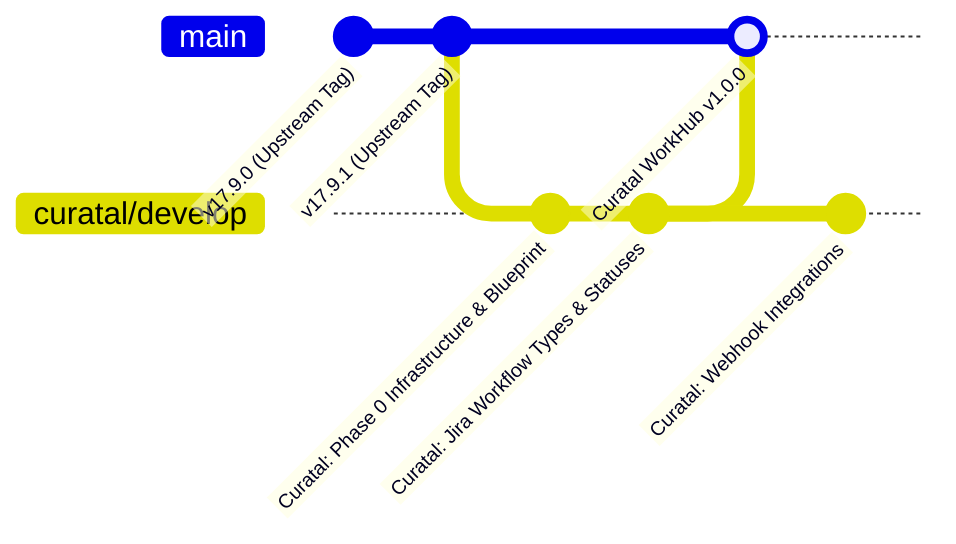

# Curatal WorkHub — Phase 0: Upstream Tracking & Upgrade Strategy

**Document ID:** `docs/08_UPSTREAM_UPGRADE_STRATEGY.md`  
**Upstream Repository:** `https://github.com/opf/openproject.git`  
**Upstream Docker Repository:** `https://github.com/opf/openproject-docker-compose.git`  
**Target Organization:** Curatal  
**Author:** Senior Software Architect & Lead DevOps Engineer  

---

## 1. Upstream Alignment Philosophy

Curatal WorkHub relies on OpenProject Community Edition as its upstream foundation. Because OpenProject actively releases security patches, bug fixes, and minor releases on its stable branch (e.g. `release/17.x`), Curatal adopts an **isolate-and-rebase** strategy:

1. **Separation of Concerns:** Application customizations reside in `curatal-workhub`; infrastructure, secrets, and deployment recipes reside in `curatal-workhub-infra`.
2. **Minimal Core Code Modification:** Future Curatal Jira-style customizations must leverage OpenProject's plugin interfaces (`modules/`), contract validators, custom fields, frontend component overrides, and REST APIs rather than directly altering core database schemas or monkey-patching critical Rails services.
3. **Traceable Git Upstream Tracking:** The `upstream` remote is permanently maintained in both repositories, pointing strictly to the official open-source repositories.

---

## 2. Git Remotes and Branching Architecture

### 2.1 Repository Remotes Configuration
```text
curatal-workhub (Application Repository):
  upstream  https://github.com/opf/openproject.git (fetch & push)
  origin    <Curatal Private GitHub WorkHub Repo>  (fetch & push)

curatal-workhub-infra (Infrastructure Repository):
  upstream  https://github.com/opf/openproject-docker-compose.git (fetch & push)
  origin    <Curatal Private GitHub WorkHub-Infra Repo>           (fetch & push)
```

### 2.2 Branching Model



- **`curatal/develop`:** Primary working branch for Curatal engineers. Anchored directly to a verified upstream release tag (`v17.9.1`, SHA: `c7ec3efaeb2740944b0368b267901b568d6f2144`).
- **`curatal/release/*`:** Stable release candidate branches tested in Staging.
- **`main`:** Production-ready code deployed to live internal environments.

---

## 3. Step-by-Step Upstream Upgrade Procedure

When OpenProject releases a new minor version (e.g., `v17.9.2` or `v17.10.0`):

### Step 1: Pre-Upgrade Assessment & Backup
1. Review the upstream release notes, breaking changes, and migration scripts at [OpenProject Release Notes](https://www.openproject.org/docs/release-notes/).
2. Execute a pre-upgrade database and asset backup (refer to `docs/03_BACKUP_RESTORE_RUNBOOK.md`):
   ```powershell
   .\curatal-workhub-infra\scripts\workhub.ps1 backup
   ```

### Step 2: Fetch and Rebase Upstream Source
```bash
cd curatal-workhub
git fetch upstream --tags

# Create an upgrade working branch from curatal/develop
git checkout -b upgrade/v17.x curatal/develop

# Rebase Curatal commits onto the new verified upstream tag
git rebase v17.10.0
```

### Step 3: Conflict Resolution
If conflicts arise:
1. Inspect conflicting files using `git status`.
2. Core Rails migrations or schema conflicts: prioritize upstream migrations; adapt Curatal custom migrations to run *after* upstream migration sequences.
3. Frontend conflicts: resolve in favor of Curatal's custom component modules while incorporating upstream security patches.
4. Finalize rebase: `git rebase --continue`.

### Step 4: Infrastructure Track Update
```bash
cd curatal-workhub-infra
git fetch upstream
git merge upstream/stable/17 --no-commit
```
Update `.env` image tags to the new target tag (e.g., `TAG=17-slim`).

### Step 5: Test Migrations on Disposable Instance
Never run migrations directly against staging without executing on a disposable development container:
```bash
docker compose -f docker-compose.yml up seeder
```
Confirm `seeder` exits with code 0.

### Step 6: Full Regression Smoke Test
Run the automated verification suite:
```bash
docker compose exec -T web bundle exec rails runner /tmp/smoke_test.rb
```
Upon passing, merge `upgrade/v17.x` into `curatal/develop`.
